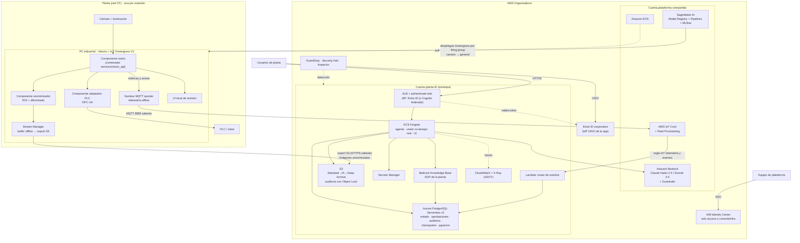

# Arquitectura de producción en AWS

> **Resumen.** Misma separación que en Azure: el ciclo imagen → robot corre **en el borde** con
> **AWS IoT Greengrass V2** en un PC industrial; la nube aloja el asistente (ECS Fargate + Amazon Bedrock),
> el estado y la auditoría (Aurora PostgreSQL Serverless v2), la recuperación de SOP (Bedrock Knowledge Bases
> sobre pgvector), las imágenes (S3 con ciclo de vida) y el MLOps (SageMaker Model Registry). Cada planta es una
> **cuenta AWS propia** dentro de AWS Organizations. Costo de nube a precio de lista: **~USD 410/mes por planta con 1 estación en us-east-1 y ~USD 464/mes en
> eu-south-2 (España)**. La mayoría de precios se verificaron en la AWS Price List Bulk API; Bedrock, NAT, GuardDuty y SSM
> son estimados (ver hoja *Fuentes* de `finops_model.xlsx`).

Este documento sigue la misma estructura que [`azure_architecture.md`](azure_architecture.md); donde la
justificación es idéntica (qué va en el borde y por qué, presupuesto de latencia, roles) se resume y se remite a él.

---

## 1. Principio de diseño

Idéntico a Azure: **determinista y local** para todo lo que mueve el robot; **agéntico y en la nube** para
asistir a las personas; **política determinista + aprobación humana** entre el LLM y cualquier acción de riesgo.
Ver [tabla en Azure §1](azure_architecture.md#1-principio-de-diseño-qué-va-dónde).

## 2. Diagrama

## 3. Borde: AWS IoT Greengrass V2

| | **Elegido: IoT Greengrass V2** | Alternativa: EKS Anywhere / ECS Anywhere | Alternativa: AWS Outposts / Snow |
|---|---|---|---|
| Encaje | Componentes (contenedores o procesos) desplegados por *thing groups*; ideal para 3-4 módulos | Útil si la planta ya opera K8s/ECS | Sobredimensionado y caro |
| Offline | **Stream Manager** con buffer local y exportación al reconectar (destinos soportados: Kinesis Data Streams, S3, IoT Analytics, IoT SiteWise → usamos **S3** para imágenes); la telemetría MQTT a IoT Core se encola offline en el *spooler* del nucleus | Construirlo | Sí |
| Costo | ~USD 0,16/dispositivo/mes (estimado) | Licencias/soporte | Alto |

Componentes equivalentes a los de Azure: `vision` (imagen con el modelo dentro), `plc-adapter`, `anonymizer`,
UI local de revisión. Gestión del SO del PC con **Systems Manager** (instancias híbridas) y aprovisionamiento con
**Fleet Provisioning** + certificados X.509 (o TPM vía PKCS#11). Red OT idéntica (IEC 62443, solo saliente).

## 4. Plano de nube

| Necesidad | Servicio y tier | Por qué | Rechazado y por qué |
|---|---|---|---|
| Hospedar agente, UI y visión cloud | **ECS on Fargate** (0,5 vCPU / 1 GB) detrás de **ALB** con `authenticate-oidc` usando **Entra ID como IdP OIDC** (o Cognito federado con Entra) | Sin servidores que parchear; el ALB autentica antes de llegar a la app y entrega los claims (roles) | **App Runner** (más simple, pero menos control de red y de autenticación); **EKS** (operar K8s para 2-3 servicios); **Lambda** (conversaciones largas con estado) |
| LLM | **Amazon Bedrock**: Claude Haiku 4.5 por defecto, Claude Sonnet 4.5 para diagnósticos | Modelos fuertes en uso de herramientas; pago por token; datos no usados para entrenar; endpoint privado (PrivateLink) | Modelos abiertos en GPU propia (costo fijo); Amazon Nova Lite (más barato; **hipótesis no medida**: podría rendir peor en tool-calling → decidir con `eval/agent`) |
| Protección del LLM | **Bedrock Guardrails** (filtros de contenido, ataques de prompt, temas denegados) | Capa equivalente a Prompt Shields | — |
| Recuperación de SOP | **Bedrock Knowledge Bases** con vector store **Aurora PostgreSQL (pgvector)** | Reutiliza la base que ya pagamos; devuelve citas (calidad frente a alternativas: no medida) | **OpenSearch Serverless** (mínimo ~USD 350/mes, desproporcionado para pocos SOP); **Kendra** (licencia alta) |
| Estado, aprobaciones, auditoría, checkpoints LangGraph | **Aurora PostgreSQL Serverless v2** (0,5–2 ACU, réplica lectora en otra AZ) | Relacional y transaccional (mismas razones que en Azure); escala con la carga de turnos; requisito de Bedrock KB | **DynamoDB** (equivalente a Cosmos: sin joins ni restricciones para "aprobador ≠ solicitante"); **RDS PostgreSQL** (válido y algo más barato fijo, pero no sirve de vector store para KB) |
| Imágenes | **S3** con lifecycle: Standard 30 d → Standard-IA → Glacier Deep Archive a 180 d → expira a 3 años; auditoría con **Object Lock** (WORM) | Barato, maduro | — |
| MLOps | **SageMaker AI**: MLflow gestionado, Pipelines (CPU, escala a cero), **Model Registry** con estados *PendingManualApproval → Approved* | El estado de aprobación del registro encaja con nuestra aprobación humana | Endpoints de SageMaker para inferencia en tiempo real (la inferencia vive en el borde) |
| Telemetría y dispositivos | **IoT Core** solo para telemetría y avisos pequeños (reglas → Lambda), **IoT Device Defender**; las imágenes van a S3 por Stream Manager | Pago por mensaje: muy barato a esta escala | **Kinesis** (como Event Hubs: solo con >20 plantas o analítica en streaming) |
| Secretos | **Secrets Manager** | Rotación integrada | Parameter Store (válido para config no secreta) |
| Identidad | Usuarios de la app: **Entra ID como IdP OIDC del ALB** (o **Cognito** federado con Entra si se quiere un pool propio). Personas que operan AWS: **IAM Identity Center** federado con Entra. Servicios: **roles IAM** | Una sola identidad corporativa | Identity Center como IdP de la app: no actúa como proveedor OIDC para aplicaciones propias detrás de un ALB |
| Observabilidad | **CloudWatch** (logs, métricas, alarmas) + **X-Ray / ADOT** para trazas del agente | Nativo | — |
| Seguridad | **GuardDuty**, **Security Hub**, **Inspector** (imágenes ECR), **VPC endpoints** | Postura y detección | — |

## 5. Identidad y roles

Los seis roles (`operator`, `supervisor`, `quality`, `maintenance`, `ml_engineer`, `plant_manager`) se modelan como
**app roles / grupos de Entra ID**; el ALB (authenticate-oidc contra Entra) entrega los claims al agente, que filtra tools
y aplica la política. Para infraestructura, IAM Identity Center federado con Entra y *permission sets* por rol (p. ej. `ml_engineer` → acceso a SageMaker en la
cuenta compartida; `plant_manager` → Billing/Cost Explorer de su cuenta). Misma regla de separación de funciones.

## 6. Aislamiento multi-planta

**Cuenta AWS por planta** (vending con **Control Tower**) dentro de una OU "Plantas", más una cuenta de plataforma
compartida. En AWS la cuenta es la frontera natural de aislamiento, permisos y facturación; con Control Tower crear
una cuenta nueva es barato y repetible. Equivale a la estampa por RG/suscripción de Azure. Planta en España →
región **eu-south-2 (Spain)**.

## 7. MLOps

Mismo flujo que Azure §7: staging → puertas automáticas (exactitud del SKU nuevo, no regresión, latencia) →
aprobación humana (estado *Approved* del Model Registry, aprobador ≠ solicitante) → imagen en ECR →
**despliegue de Greengrass a un thing group "canario"** (sombra → activo) → despliegue general o **rollback** al
despliegue anterior. Ver [`04_secuencia_onboarding_sku.md`](../diagrams/04_secuencia_onboarding_sku.md).

## 8. Seguridad y cumplimiento

Mismos controles que Azure §8 con sus equivalentes: Bedrock Guardrails ↔ Prompt Shields; Object Lock ↔ inmutabilidad Blob;
Secrets Manager ↔ Key Vault; GuardDuty/Inspector ↔ Defender; SCPs de Organizations para impedir desactivar
CloudTrail o sacar datos de la región. Anonimización en el borde antes de subir. Ley 1581 / RGPD igual que en Azure.

## 9. HA/DR

La línea no depende de la nube (inferencia local + Stream Manager + spooler MQTT). Aurora con réplica en otra AZ (failover < 1 min) y
backups continuos (PITR); ECS con tareas en 2 AZ; para desastre regional, redespliegue por IaC (CDK/Terraform) y
restauración de snapshot copiado a otra región. Objetivos iguales a los de Azure §9.

## 10. Latencia

Idéntica a Azure §10 (el camino crítico no toca la nube): pipeline de visión **medido** p50 13,6 ms / p95 22,6 ms;
**≈ 33–65 ms hasta el PLC** sumando captura y PLC estimados; presupuesto < 100 ms.

## 11. Costos (resumen)

| Bloque | us-east-1 (USD/mes) | eu-south-2 (USD/mes) |
|---|---|---|
| Plataforma fija (Aurora 2×1 ACU, 2 tareas Fargate, ALB, NAT, VPC endpoints, GuardDuty, …) | ≈ 363 | ≈ 413 |
| Por estación (S3, IoT Core, Greengrass, SSM) | ≈ 11 | ≈ 12 |
| LLM (Claude Haiku 4.5 + 15% Sonnet 4.5, **estimado**) | ≈ 36 | ≈ 40 (EE. UU. × factor UE) |
| **Total** | **≈ 410** | **≈ 464** |

Comparación detallada y por qué AWS sale más barato en este modelo: [`azure_vs_aws.md`](azure_vs_aws.md).
