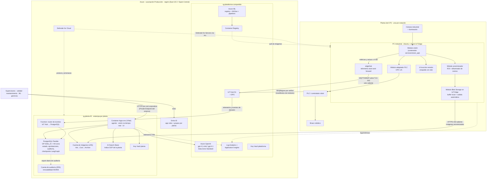

# Arquitectura de producción en Azure

> **Resumen para defender en 30 segundos.** El ciclo cámara → decisión → robot corre **en el borde**
> (un PC industrial junto a la línea, gestionado con **Azure IoT Edge**) porque tiene que funcionar en
> milisegundos y aunque se caiga internet. La **nube** (Azure Container Apps, Azure OpenAI, AI Search,
> PostgreSQL, Blob, Azure ML) aloja todo lo que no es tiempo real: el asistente agéntico, la cola de
> revisión, la auditoría, el entrenamiento y el registro de modelos. Cada planta es una **estampa**
> aislada (su propio grupo de recursos, base de datos y almacenamiento). Costo de nube estimado a precio de lista: **~USD 640/mes
> por planta con 1 estación en East US 2 (escenario Colombia) y ~USD 740/mes en Spain Central (escenario España)**
> (ver `finops_model.xlsx`), frente a **≈ USD 2.490 (Colombia) – 12.280 (España)/mes** que cuesta hoy el operador de esa estación
> (supuestos laborales editables).

Índice: [1. Principio de diseño](#1-principio-de-diseño-qué-va-dónde) · [2. Diagrama](#2-diagrama) ·
[3. Borde](#3-borde-la-planta) · [4. Nube](#4-plano-de-nube-servicio-por-servicio) ·
[5. Identidad y roles](#5-identidad-y-roles-entra-id) · [6. Multi-planta](#6-aislamiento-multi-planta) ·
[7. MLOps](#7-mlops-de-sku-nuevo-a-borde-con-canario) · [8. Seguridad](#8-seguridad-y-cumplimiento) ·
[9. HA/DR](#9-alta-disponibilidad-y-recuperación) · [10. Latencia](#10-presupuesto-de-latencia-imagen--robot) ·
[11. Costos](#11-costos) · [12. Riesgos abiertos](#12-riesgos-y-decisiones-abiertas)

---

## 1. Principio de diseño: qué va dónde

| Parte | Naturaleza | Dónde corre | Por qué |
|---|---|---|---|
| Captura, compuerta de calidad, clasificación, ángulo, decisión ACT/REVIEW/REJECT, comando al robot | **Determinista** (ML clásico, umbrales) | **Borde** (PC industrial en la celda) | Latencia < 100 ms, no puede depender de internet ni de un LLM; un error aquí mueve un robot |
| Cola de revisión (captura del caso) | Determinista | Borde (buffer local) → nube | Debe seguir encolando aunque no haya red |
| Interfaz de revisión, métricas, auditoría | Determinista | Nube (y vista local de respaldo en el borde) | Acceso de supervisores desde cualquier sitio |
| Asistente conversacional, diagnóstico con SOP, propuesta de acciones | **Agéntico** (LLM) | **Nube** | Necesita LLM grande, no está en el camino crítico; si cae, la línea sigue |
| Política RBAC, aprobaciones, ejecutor de acciones | **Determinista** | Nube | Una regla de seguridad no puede depender de un prompt |
| Reentrenamiento, registro, promoción de modelos | Determinista + humano | Nube → despliegue al borde | Cómputo esporádico, trazabilidad, aprobación |

**En lenguaje llano:** lo que mueve el robot es código predecible pegado a la máquina; la IA generativa
asesora a las personas desde la nube y nunca toca la planta sin pasar por reglas y, si es riesgoso, por un humano.

---

## 2. Diagrama

Todos los PaaS de la estampa tienen **acceso público deshabilitado** y se alcanzan por **Private Endpoints**
desde la VNet del entorno de Container Apps. El propio entorno de Container Apps se publica con un **Private Endpoint**
(USD 0,10/h verificado): el chat solo es accesible desde la red corporativa. El borde solo abre conexiones **salientes**
a IoT Hub (telemetría), a la cuenta de imágenes (Blob) y a ACR. **Las imágenes no viajan por IoT Hub** (cada mensaje de
IoT Hub cuenta en bloques de 4 KB; una imagen de 150 KB consumiría ~38 mensajes).

---

## 3. Borde (la planta)

### 3.1 Elección: Azure IoT Edge sobre Ubuntu en un PC industrial

| | **Elegido: Azure IoT Edge** | Alternativa: AKS Edge Essentials / Arc-enabled Kubernetes | Alternativa: Azure Stack Edge |
|---|---|---|---|
| Qué es | Runtime que ejecuta contenedores ("módulos") y los gestiona desde IoT Hub | Kubernetes ligero (K3s/K8s) en Windows, gestionado por Azure Arc | Appliance de hardware de Microsoft con GPU |
| Encaje | 3-4 contenedores por estación; despliegue declarativo por tags | Tiene sentido con decenas de servicios por planta o equipo que ya opera K8s | Sobredimensionado: el modelo es CPU y pesa MB |
| Offline | `edgeHub` guarda y reenvía mensajes (TTL configurable, p. ej. 7 días) | Hay que construir el buffer | Similar a IoT Edge |
| Costo | Runtime gratis; se paga IoT Hub (USD 25/mes S1) | USD 2,5/dispositivo/mes + complejidad K8s | Alquiler mensual de cientos de USD |
| Riesgo operativo | Bajo; patrón muy documentado para manufactura | Medio-alto (operar Kubernetes en planta) | Bajo pero caro |

**Por qué:** nuestro modelo es ML clásico en CPU (milisegundos, artefacto pequeño). No necesitamos GPU ni
orquestación compleja; necesitamos **despliegue remoto confiable, rollback y operación offline**, que es justo
lo que da IoT Edge. Si una planta grande quisiera consolidar varias líneas en un clúster, AKS Edge Essentials
es el siguiente paso natural y el mismo contenedor sirve.

**Riesgo de roadmap (honesto):** la apuesta estratégica de Microsoft para nuevos proyectos industriales es
**Azure IoT Operations** (sobre Kubernetes habilitado por Arc). IoT Edge sigue soportado y es lo más simple para este
alcance; como el módulo de visión es un contenedor estándar, migrar a IoT Operations / AKS Edge no toca la aplicación.

### 3.2 Módulos en el PC de borde

| Módulo | Función | Notas |
|---|---|---|
| `vision` | El mismo contenedor de `services/vision_api` con el modelo **dentro de la imagen** (versión inmutable) | Rollback = volver a la imagen anterior; no hay descarga de modelo en caliente |
| `plc-adapter` | Traduce `robot_command` a OPC UA (o Profinet/Modbus vía gateway) | Si el PLC no recibe ACK en N ms → HOLD (falla segura) |
| `anonymizer` | Recorta a la región de la banda (ROI) y difumina rostros/personas antes de subir cualquier imagen | El recorte ROI es el control principal; el difuminado (detector de rostros ligero) es la segunda barrera |
| `blob-edge` | Módulo **Azure Blob Storage on IoT Edge**: guarda las imágenes anonimizadas en disco local y las sube solo (*deviceToCloudUpload*) a la cuenta de imágenes cuando hay red | Verificar la vigencia del módulo al iniciar el proyecto; alternativa equivalente: subida directa con SAS de corta duración emitido por la nube. En ambos casos IoT Hub solo lleva un aviso con la referencia |
| `edgeHub` / `edgeAgent` | Telemetría con store-and-forward y ciclo de vida de módulos | Disco local dimensionado para ≥ 7 días sin red |
| `review-ui` (respaldo) | Vista local de la cola si no hay internet | Los casos se sincronizan al volver la red |

**Hardware sugerido (estimado):** PC fanless con CPU x86 de 4-8 núcleos, 16-32 GB RAM, SSD industrial
256-512 GB, doble NIC (OT / IT), TPM 2.0 para atestación con DPS. Cámara GigE o USB3 con iluminación
controlada (la iluminación es la mayor fuente de error en visión clásica).

### 3.3 Red OT

El PC de borde vive en una zona intermedia (modelo de zonas y conductos **IEC 62443**): una NIC hacia la
red del PLC, otra hacia la red IT con salida solo a `*.azure-devices.net` (8883/443), a la cuenta de imágenes y al ACR. Ninguna
conexión entrante desde internet. Esto es lo que normalmente exige el equipo de OT antes de aprobar cualquier proyecto.

---

## 4. Plano de nube servicio por servicio

### 4.1 Azure Container Apps — agente, visión no-tiempo-real y UI

- **Qué corre:** el agente LangGraph (`services/agent`), una instancia de la API de visión para inspección
  desde el chat y para *staging* de SKU nuevos, y la UI.
- **SKU:** entorno con perfil **Consumption** integrado a VNet, con **redundancia de zona** y **Private Endpoint** de entrada.
  Agente: 0,5 vCPU / 1 GiB por réplica, **mínimo 2 réplicas en horario de turnos** (una por zona: sin 2 réplicas la
  redundancia de zona no sirve) y 0 los fines de semana; visión cloud: 1 vCPU / 2 GiB, escala a cero.
- **Precio verificado:** USD 0,000024 por vCPU-segundo y 0,000003 por GiB-segundo en East US 2; 0,000034 y 0,000004 en
  Spain Central; Private Endpoint del entorno 0,10 (EE. UU.) / 0,13 (Spain Central) USD/h (API de precios, 2026-10-24).
- **Por qué:** escala a cero, revisiones con *traffic splitting* (canario del agente), autenticación integrada con
  Entra ID, identidad administrada y no obliga a operar Kubernetes.
- **Rechazadas:** **AKS** (potente pero excesivo para 2-3 servicios, costo fijo de nodos y operación);
  **App Service** (válido, pero no escala a cero y el modelo por plan es menos eficiente para tráfico de turnos);
  **Azure Functions** (el agente mantiene conversaciones largas y estado; encaja mal con ejecución por evento).

### 4.2 Azure OpenAI — el LLM del agente

- **Modelos:** `gpt-4.1-mini` como **modelo por defecto** (≈85% de las conversaciones: consultas, cola,
  traspaso de turno) y `gpt-4.1` solo para **diagnósticos complejos** (enrutamiento por tipo de intención).
  Cualquier cambio de modelo (p. ej. a una familia más nueva) se decide pasando el set de evaluación de
  `eval/agent/` antes de cambiar, no por anuncio del proveedor.
- **Tipo de despliegue:** **Data Zone Standard** (pago por uso; los datos se procesan dentro de la zona EE. UU. o UE).
  Para una planta en España → Data Zone UE; cumple residencia de datos sin pagar capacidad dedicada.
- **PTU vs pago por uso:** pago por uso. Volumen estimado ~1.300 conversaciones/mes ≈ 35 M tokens/mes ≈
  **USD 20/mes** de LLM. Las PTU (capacidad reservada) tienen un mínimo de unidades que cuesta del orden de cientos de USD al día (estimado, verificar); solo
  convienen con tráfico alto y constante o latencia garantizada. **Regla:** revisar PTU si el gasto LLM
  supera de forma sostenida el costo mensual de la unidad mínima de PTU.
- **Precios verificados (API, Data Zone, iguales en East US 2 y Spain Central):** gpt-4.1-mini entrada USD 0,44 / 1M tokens,
  caché 0,11, salida 1,76; gpt-4.1 entrada 2,20, caché 0,55, salida 8,80.
- **Filtros de contenido:** se dejan los filtros por defecto (odio, violencia, sexual, autolesión) y se activan
  **Prompt Shields** (jailbreak e **inyección indirecta**: el agente lee SOP, tickets y textos que podrían contener
  instrucciones maliciosas). El filtro es una capa más: la defensa real es que las acciones las autoriza la política determinista.
- **Rechazadas:** modelos abiertos autoalojados en GPU (costo fijo de GPU 24×5 para un volumen pequeño);
  llamar directamente a la API pública de OpenAI/Gemini (sin red privada, sin residencia ni acuerdos empresariales de Azure).

### 4.3 Azure AI Search — recuperación de SOP con citas

- **SKU:** **Basic** (USD 0,101/h ≈ 74/mes, verificado). Un índice por planta con búsqueda **híbrida**
  (palabras clave + vectores) y ranker semántico (cuota gratuita mensual suficiente).
- **Por qué (hipótesis a validar):** los SOP mezclan códigos exactos ("SOP-CAM-01", "CAM-01.4") y lenguaje natural;
  esperamos que la búsqueda híbrida recupere mejor ambos que solo vectores. **No está medido**: se validaría con los casos
  de `eval/agent/` comparando AI Search contra pgvector antes de comprometer el gasto. Devuelve el fragmento y su origen para **citar**. Vectorización integrada con un modelo de embeddings de Azure OpenAI.
- **Trade-off honesto:** para un corpus de decenas de SOP, **pgvector en la misma PostgreSQL** costaría USD 0 adicional.
  Elegimos AI Search por la capacidad híbrida + semántica integrada y la separación de responsabilidades; si el presupuesto
  aprieta, es la primera línea a recortar (−74 USD/mes por planta).

### 4.4 Azure Database for PostgreSQL Flexible Server — estado y auditoría (elegida frente a Cosmos DB)

- **SKU:** General Purpose **D2ds_v5** (2 vCore, USD 0,178/h East US 2 · 0,212/h Spain Central, verificado), 64 GB SSD, **HA con réplica en otra zona**
  en producción; en piloto, Burstable B2ms sin HA.
- **Qué guarda:** conversaciones y **checkpoints de LangGraph** (`langgraph-checkpoint-postgres`, el checkpointer oficial),
  aprobaciones, tickets, cola de revisión, eventos de decisión agregados y la **auditoría**.
- **Por qué PostgreSQL y no Cosmos DB:**
  1. Los datos son **relacionales y transaccionales**: una aprobación referencia una solicitud, un usuario, un rol
     y un cambio; la regla "aprobador ≠ solicitante" se puede imponer con una restricción en la base.
  2. La demo ya usa SQL (SQLite) → migración casi directa.
  3. Costo predecible (vCore) frente al modelo de RU de Cosmos, difícil de estimar con consultas analíticas.
  4. No necesitamos distribución global multi-región de escritura, que es la gran ventaja de Cosmos.
- **Auditoría inmutable:** tabla de solo inserción (sin `UPDATE`/`DELETE` para el rol de la app) + exportación diaria
  a la **cuenta de auditoría** (ZRS) con **política de inmutabilidad (WORM)**.

### 4.5 Blob Storage — imágenes y evidencia

- **Qué se sube:** solo imágenes **anonimizadas** de casos REVIEW/REJECT y una muestra (~2%) de ACT para auditoría y reentrenamiento.
- **Ciclo de vida:** Hot 30 días (revisión y reentrenamiento) → Cool hasta el día 180 → Archive hasta 3 años → borrado.
  Precios verificados (LRS): Hot 0,0184, Cool 0,01, Archive 0,002 USD/GB-mes.
- **Dos cuentas de almacenamiento**, porque la redundancia se elige **por cuenta**, no por contenedor:
  - **Cuenta de imágenes — LRS** con ciclo de vida Hot→Cool→Archive (Archive **no** admite ZRS/GZRS; además las imágenes
    son evidencia reemplazable).
  - **Cuenta de auditoría — ZRS** (Hot ZRS 0,023 USD/GB-mes verificado) con inmutabilidad WORM y sin tier Archive.
- **Cómo llegan:** desde el módulo Blob Storage on IoT Edge del PC de planta, directo a la cuenta de imágenes (no por IoT Hub).
- **Por qué no guardar todo:** 600 objetos/h × 520 h × 150 KB ≈ 45 GB/mes por estación si se subiera todo; subiendo
  solo ~7% son ~3 GB/mes. Menos datos = menos costo, menos riesgo de privacidad.

### 4.6 Azure Machine Learning — registro, seguimiento y reentrenamiento

- **Workspace por entorno** + **Azure ML Registry** compartido (los modelos aprobados se publican una vez y se consumen
  desde todas las plantas).
- **MLflow** como tracking (el repo ya usa MLflow → los runs locales y los de Azure ML tienen el mismo formato).
- **Pipeline de reentrenamiento** en un compute cluster CPU que **escala a cero** (minutos de cómputo por corrida).
- **Rechazado:** endpoints gestionados de Azure ML para inferencia en tiempo real; la inferencia vive en el borde.

### 4.7 IoT Hub (+ DPS) — telemetría y gestión de dispositivos

- **SKU:** **S1** (USD 25/mes, 400.000 mensajes/día de hasta 4 KB, verificado). **Solo telemetría y avisos pequeños**:
  ~3.000 mensajes de telemetría + ~1.000 avisos de imagen subida (uno por imagen, con su referencia) ≈ 4.000/día por
  estación → unas 100 estaciones por unidad. Si las imágenes pasaran por IoT Hub serían ~40.000 mensajes/día por estación
  (≈ 9 estaciones por unidad): por eso van directo a Blob. **No usar Basic**: no permite cloud-to-device ni IoT Edge.
- **Device Provisioning Service** con atestación **TPM/X.509**: un PC nuevo se registra solo, sin copiar claves a mano.
- **Despliegues en capas (layered deployments)** por tags (`planta`, `linea`, `anillo=canario|general`) → base del canario de modelos.
- **Ruteo de mensajes:** telemetría y eventos de decisión → Event Grid → Function → PostgreSQL (las imágenes no pasan por aquí).

### 4.8 ¿Event Hubs / Stream Analytics? No, por ahora

Con decenas de estaciones, el endpoint integrado de IoT Hub + una Function bastan. Se incorporarían **Event Hubs**
(o Fabric Real-Time Intelligence) cuando haya >20 plantas o se necesite analítica en ventanas de tiempo en tiempo real
(p. ej. detectar deriva del % REVIEW en 5 minutos en todas las líneas). Añadirlos hoy sería costo y complejidad sin uso.

### 4.9 Key Vault, observabilidad y Defender

- **Key Vault** (Standard): secretos que no se pueden evitar (token admin del servicio de visión, credenciales OPC UA).
  Todo lo demás usa **identidades administradas** (sin claves en código ni en variables).
- **Azure Monitor + Application Insights + Log Analytics:** trazas OpenTelemetry del agente (cada tool call, tokens,
  costo, latencia), métricas de negocio (% ACT, % REVIEW por línea), logs de los módulos de borde. Alertas: % REVIEW > umbral,
  dispositivo desconectado > 5 min, gasto LLM diario > presupuesto.
- **Defender for Cloud:** postura (CSPM gratis), Defender for Containers (escaneo de imágenes en ACR), Defender for Storage
  en las dos cuentas y **Defender for Servers en los PC de borde vía Azure Arc** (el PC de planta es el activo más expuesto).

---

## 5. Identidad y roles (Entra ID)

Un registro de aplicación con **app roles** que son exactamente los roles del sistema; los grupos de Entra por planta
se asignan a esos roles. El token trae `roles` y la planta; el agente **filtra las tools** por rol y la política
determinista valida cada acción. Acceso privilegiado a infraestructura con **PIM** (just-in-time).

| Rol de la app | Grupo ejemplo | Qué puede en el agente | Rol Azure (infra) |
|---|---|---|---|
| `operator` | `PLT-BOG-Operadores` | Consultar estado, ver su cola | — |
| `supervisor` | `PLT-BOG-Supervisores` | Cola, métricas, **aprobar** cambios operativos, traspaso de turno | — |
| `quality` | `PLT-BOG-Calidad` | Revisar casos, etiquetar, **solicitar** alta de SKU | Storage Blob Data Reader (contenedor de evidencia de su planta) |
| `maintenance` | `PLT-BOG-Mantenimiento` | Diagnóstico, tickets, **solicitar** cambios de umbral | — |
| `ml_engineer` | `GLB-ML-Engineers` | Métricas de modelo, **aprobar** promociones y rollbacks | AzureML Data Scientist; AcrPush vía pipeline |
| `plant_manager` | `PLT-BOG-Gerencia` | Reportes, costos, **aprobar** cualquier acción de su planta | Cost Management Reader (su RG) |

Separación de funciones: nadie aprueba su propia solicitud (regla en la política y restricción en la base).

---

## 6. Aislamiento multi-planta

**Decisión: patrón de "estampas" (deployment stamps) — un grupo de recursos por planta con datos propios,
sobre una plataforma compartida.**

| Opción | Pros | Contras | Veredicto |
|---|---|---|---|
| Base compartida con aislamiento por fila (`plant_id`) | Más barata | Un bug de filtro expone datos de otra planta; auditoría y residencia difíciles | Rechazada para datos operativos |
| **RG por planta (estampa) + plataforma compartida** | Aislamiento fuerte de datos (PG, Blob, Search, Key Vault propios), RBAC por RG, costo por planta trivial (showback), mismo IaC repetido | ~USD 600/mes fijos por planta | **Elegida** |
| Suscripción por planta (landing zone) | Máximo aislamiento, límites y políticas independientes | Más gobierno; útil con >10 plantas o entidades legales distintas | Evolución natural |

Lo compartido (IoT Hub, ACR, Azure ML Registry, Azure OpenAI, Log Analytics) no guarda datos de negocio de una
planta o los separa por identidad del dispositivo. Una planta en España se despliega como estampa en **Spain Central**
con Azure OpenAI **Data Zone UE**: misma plantilla Bicep, distinta región.

---

## 7. MLOps: de SKU nuevo a borde con canario

1. **Staging** — calidad sube fotos del SKU con su ángulo (chat o UI). `POST /v1/skus/stage` entrena un candidato
   (pipeline de Azure ML en producción) y devuelve si las vistas son suficientes y las métricas.
2. **Puertas automáticas** — exactitud en el SKU nuevo ≥ umbral, **sin regresión** en SKUs existentes (> 0,5 pp),
   latencia p95 en CPU dentro del presupuesto. Todo queda en MLflow con el hash de datos.
3. **Aprobación humana** — `ml_engineer` o `plant_manager`, distinto de quien solicitó.
4. **Registro** — la versión se publica en el Azure ML Registry y se construye la imagen `vision:<versión>` en ACR.
5. **Canario en el borde** — despliegue en capas de IoT Hub a las estaciones con tag `anillo=canario`:
   primero **modo sombra** (decide en paralelo, no manda al robot) y luego activo. Se compara % ACT, % REVIEW y latencia
   contra la versión anterior durante una ventana (p. ej. un turno).
6. **Despliegue general o rollback** — si las métricas empeoran, el despliegue de mayor prioridad se retira y los
   dispositivos vuelven a la imagen anterior en minutos. La imagen anterior queda cacheada en el PC.

Ver diagrama: [`docs/diagrams/04_secuencia_onboarding_sku.md`](../diagrams/04_secuencia_onboarding_sku.md).

---

## 8. Seguridad y cumplimiento

| Riesgo | Control |
|---|---|
| El LLM ejecuta algo peligroso (alucinación o inyección de prompt en un SOP/ticket) | Tools filtradas por rol; política determinista; acciones de riesgo con `interrupt` + aprobación; el ejecutor aplica el diff aprobado, no una nueva salida del LLM; Prompt Shields |
| Robot recibe un ángulo dudoso | Imposible por diseño: si `decision != ACT` el comando es `HOLD` |
| Fuga de imágenes con personas | Recorte ROI + difuminado en el borde **antes** de subir; Blob privado; retención limitada |
| Robo/manipulación del PC de planta | TPM + DPS, disco cifrado, Defender for Servers vía Arc, sin puertos entrantes |
| Secretos expuestos | Identidades administradas; Key Vault; nada en `.env` en producción |
| Acceso indebido entre plantas | Estampa por planta; RBAC por RG; claims de planta en el token |
| Cambios no trazables | Auditoría append-only + WORM; IaC (Bicep) con revisiones en Git; despliegues con identidad federada (OIDC) desde CI |

**Cumplimiento:** Ley 1581 de 2012 (Colombia) y **RGPD** (España) si las imágenes pudieran contener personas →
minimización (solo casos dudosos), anonimización en origen, retención definida, residencia (Data Zone UE / Spain Central).
Para OT, alineación con **IEC 62443**. Azure aporta certificaciones ISO 27001/SOC 2 de la plataforma, pero el control
de datos y accesos es nuestro.

---

## 9. Alta disponibilidad y recuperación

| Componente | Falla | Efecto | Mitigación | RTO / RPO (objetivo) |
|---|---|---|---|---|
| Internet / Azure | Caída | **La línea sigue**; el chat no está disponible | Inferencia local, edgeHub guarda hasta 7 días, UI de revisión local | Línea: 0 / 0 |
| PC de borde | Falla de hardware | La estación cae a modo manual | PC de repuesto preaprovisionado (DPS lo registra solo); en líneas críticas, par activo/pasivo | 30 min / n.a. |
| Cámara | Falla | Todo sale como REJECT (falla segura) | Alarma inmediata por % REJECT; repuesto en planta | 30 min |
| Agente (Container Apps) | Caída de réplica/zona | Chat sigue en la otra réplica | 2 réplicas mínimas en zonas distintas (presupuestadas) | Segundos / 0 |
| PostgreSQL | Caída de zona | Agente sin estado | HA de zona con failover automático; PITR 7-35 días | < 2 min / ≈ 0 |
| Región Azure | Caída regional | Chat y cola en nube no disponibles | Redespliegue de la estampa por IaC en región pareada + restauración geo de backups | 4-8 h / < 1 h |

La clave: **la nube puede fallar sin parar la producción**. Por eso no se paga multi-región activa-activa.

---

## 10. Presupuesto de latencia imagen → robot

| Etapa | Estimado | Comentario |
|---|---|---|
| Captura (exposición + transferencia) | 10–20 ms | Depende de cámara e interfaz |
| Pipeline de visión completo (calidad + características + clase + ángulo + decisión) | **p50 16,8 ms · p95 39,5 ms · media 19,9 ms** | **Medido** en CPU de portátil, `docs/report/results.json` (`cost.latency`) |
| Envío al PLC (OPC UA, red local) | 5–20 ms | Estimado |
| **Total hasta el PLC** | **≈ 32–80 ms (presupuesto: < 100 ms)** | Frente a un ciclo de ~6 s por objeto. Con p95 de visión, el total queda < 80 ms |
| *Alternativa en la nube* | +60–150 ms de ida y vuelta + jitter + caídas | **Rechazada**: no aporta y añade un punto de falla |

*Captura y PLC son estimaciones; el pipeline de visión está medido en la demo (no en el PC industrial). Validar en el piloto con la cámara real.*

---

## 11. Costos

Detalle con fórmulas en [`finops_model.xlsx`](finops_model.xlsx) y prácticas en [`finops.md`](finops.md).
Escenario base: 1 planta, 1 estación, **92,2% automatizado (medido** en test, protocolo A), precios de lista por región.

| Bloque | East US 2 (USD/mes) | Spain Central (USD/mes) | Fuente del precio |
|---|---|---|---|
| Plataforma fija (PG HA, 2 réplicas del agente, Private Endpoints, AI Search, IoT Hub, observabilidad, Defender, cuenta de auditoría) | ≈ 598 | ≈ 700 | Mayoría verificada en la API de precios (medidores en la hoja *Fuentes*) |
| Por estación (cuenta de imágenes, Defender en PC de borde) | ≈ 20 | ≈ 20 | Verificado |
| LLM del asistente (~1.300 conversaciones/mes) | ≈ 20 | ≈ 20 | Verificado (Data Zone) |
| **Total nube** | **≈ 637** | **≈ 741** | |

Los mayores costos son **PostgreSQL con HA (≈ 275)**, los **Private Endpoints** (≈ 73 del entorno + ≈ 44 de PaaS),
**AI Search (≈ 74)** y las **2 réplicas del agente (≈ 56)**, no el LLM. El costo de la nube es
pequeño frente al costo laboral evitado; el número que más mueve el caso de negocio es el **% automatizado**: con 92,2% el ahorro es ≈ 29% en Colombia
(payback ≈ 71 meses con 1 estación, ≈ 22 con 5) y ≈ 50% en España (≈ 8 meses); el equilibrio está en ≈ 86% (CO) / 81% (ES),
y con el 77% medido con objetos desconocidos no hay ahorro.

---

## 12. Riesgos y decisiones abiertas

- **Iluminación real de la planta** distinta a COIL-100 → el piloto debe recolectar datos propios antes de prometer % ACT.
- **Simetrías rotacionales** de productos reales → el sistema ya las marca como `rotational_ambiguity` y manda a revisión;
  hay que medir cuántos SKUs las tienen.
- **Integración con el PLC/robot concreto** (protocolo, convención de signo del ángulo) es el mayor riesgo de cronograma.
- **Región:** a la fecha de este documento no conocemos una región de Azure disponible en Colombia (verificar); una planta
  colombiana usaría East US 2 o Brazil South (la latencia es irrelevante porque el camino crítico es local).
