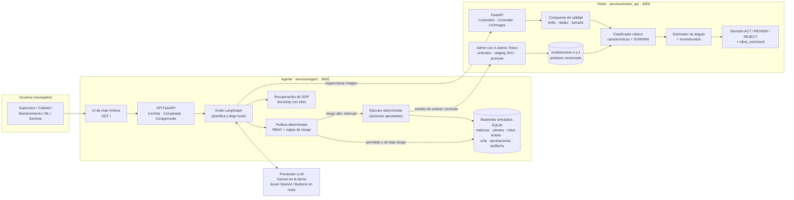

# Diagrama 1 — Arquitectura del sistema (demo local)

Qué corre en la demo y cómo se conecta. Las piezas están separadas igual que en producción:
la visión es un servicio propio (en producción vive en el borde, junto a la línea) y el agente
es otro servicio que la consume como una herramienta más.

**Lectura en una frase:** el LLM solo *propone*; lo que toca la planta pasa por una política
determinista y, si es riesgoso, por una aprobación humana antes de que un ejecutor
determinista lo aplique y lo deje auditado.
