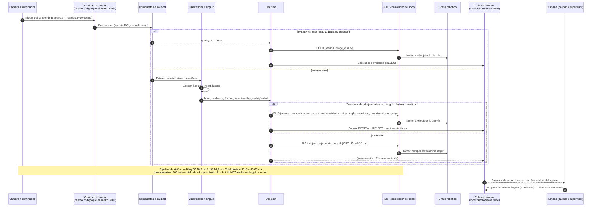

# Diagrama 2 — Secuencia "imagen → robot" (ciclo en tiempo real)

Todo este ciclo es **determinista y corre en el borde** (PC industrial junto a la línea).
No hay LLM ni dependencia de internet en este camino. La nube solo recibe, después y de
forma asíncrona, la evidencia de los casos dudosos.

| Paso | Dónde | ¿Determinista? | Latencia estimada |
|---|---|---|---|
| Captura | Cámara | Sí | 10–20 ms (estimado: exposición + transferencia GigE/USB3) |
| Pipeline de visión completo (calidad + características + clase + ángulo + decisión) | PC de borde | Sí | **Medido (vision-1.0.1): p50 18,0 ms · p95 24,6 ms · media 16,8 ms** |
| Envío al PLC | Red OT local | Sí | 5–20 ms (estimado) |
| **Total hasta el PLC** | | | **≈ 33–65 ms; presupuesto < 100 ms** |

*Captura y PLC son estimaciones de diseño. El pipeline de visión está medido en la demo (CPU de portátil,
`docs/report/results.json` → `cost.latency`); hay que repetir la medición en el PC industrial del piloto.*
