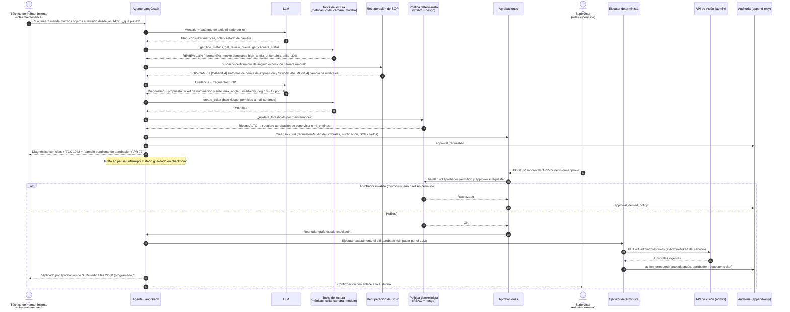

# Diagrama 3 — Flujo agéntico complejo con aprobación humana

Ejemplo: un técnico de mantenimiento reporta muchos casos en REVIEW en la línea 2. El agente
diagnostica, cita el SOP y **propone** un cambio de umbral (o un rollback de modelo). Como es una
operación de riesgo, el grafo se pausa (`interrupt`) hasta que un supervisor **distinto** de quien
lo pidió la apruebe. Solo entonces un ejecutor determinista la aplica y la audita.

**Puntos a defender**
- El LLM nunca llama directamente a la acción riesgosa: la política es código, no prompt.
- El ejecutor aplica *el diff aprobado*, no una nueva generación del LLM (evita que lo aprobado y lo ejecutado difieran).
- Separación de funciones: quien pide no aprueba. Todo queda en una auditoría de solo inserción.
- Variante rollback de modelo: el mismo flujo con `POST /v1/admin/promote` hacia la versión anterior (SOP-ML-04 [ML-04.2]).
- Los SOP citados existen en `docs/sop/`; las cifras del ejemplo (18%, 14:00, TCK-1042, APR-77) son ilustrativas.
