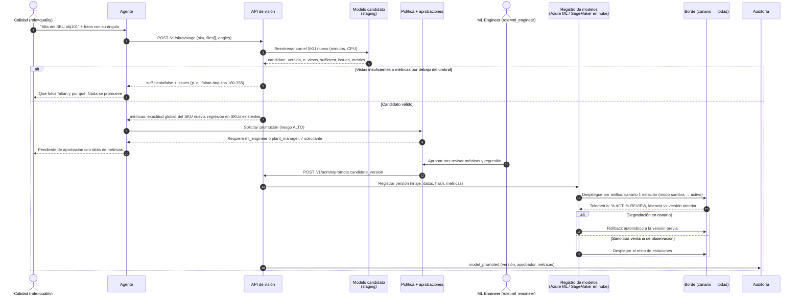

# Diagrama 4 — Alta de un SKU nuevo (staging → métricas → aprobación → promoción)

En la demo los pasos de staging, aprobación y promoción son reales (endpoints de la API de visión);
el registro en la nube y el despliegue por anillos al borde son el diseño de producción
(ver `docs/cloud/azure_architecture.md` §MLOps).
